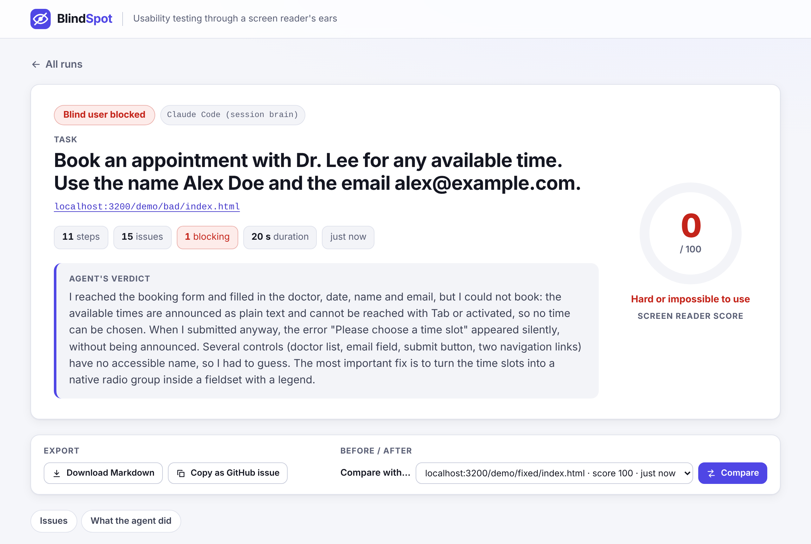
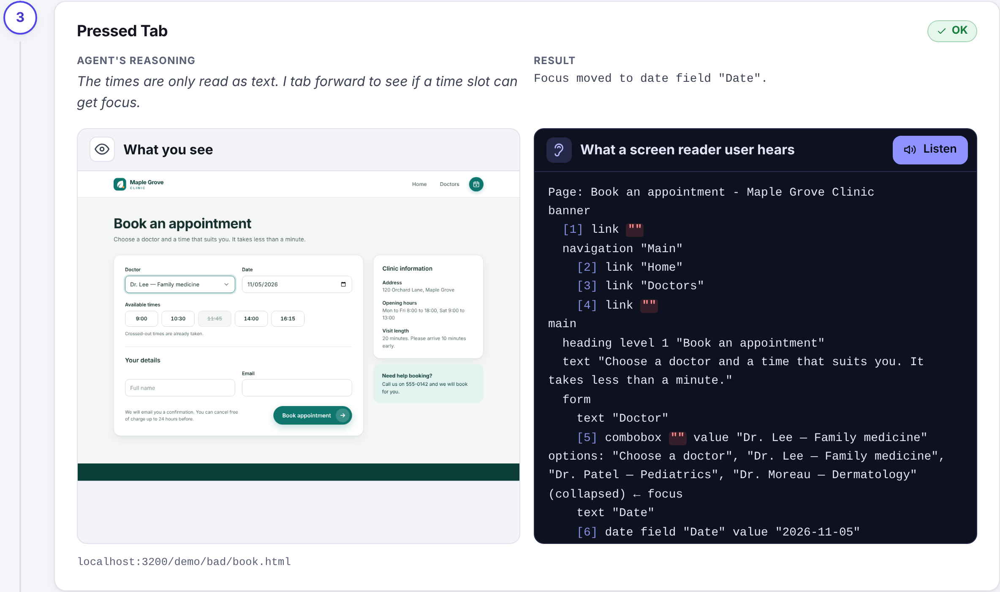
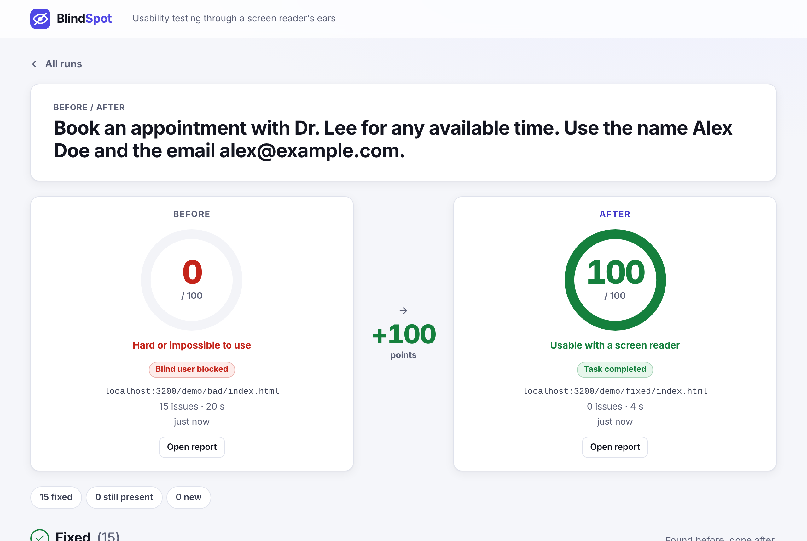

# BlindSpot

**Lighthouse checks rules. BlindSpot checks whether a blind person can actually use your site.**

Give BlindSpot a URL and a task in plain language ("Book an appointment with Dr. Lee"). An AI agent tries to
complete it using **only what a screen reader announces**. It never sees the page. You get a report: did the task
succeed, where the agent got stuck, which WCAG 2.2 criteria are involved, and the code fix.



Built solo for [GenHacks 2026](https://genhacks-open.devpost.com), track *AI, Agentic Systems, Cybersecurity, and Dev Tools*.

---

## The problem

- The WHO estimates that **at least 2.2 billion people** live with a near or distance vision impairment
  (*World report on vision*, 2019). Blind and low-vision people who use screen readers depend on websites
  exposing the right structure to assistive technology.
- WebAIM's yearly *WebAIM Million* survey keeps finding detectable WCAG failures on **the vast majority** of the
  top one million home pages.
- Automated checkers (Lighthouse, axe) are great at rules: "this button has no name". They do not answer the
  question that matters: **can a screen reader user finish signing up, paying, or booking?** A page can pass most
  rules and still be a dead end, and a page with some warnings can still be usable.

BlindSpot tests the **journey**, not just the markup.

## Result on the demo clinic

The repository ships a fictional clinic, *Maple Grove Clinic*, in two versions that are **pixel-identical** (a test
compares byte-equal screenshots). Only the accessibility tree differs.

| Version | Agent result | Score | Issues |
|---|---|---|---|
| `demo-site/bad/` | **Blocked** after 12 steps: "Time slots cannot be selected" | 0/100 | 15 |
| `demo-site/fixed/` | **Success**: appointment booked | 100/100 | 0 |

These are from a run where Claude played the screen reader user through BlindSpot's external-agent API. The time
slots are clickable `<div>`s: a screen reader announces them as plain text, and pressing Tab jumps from the date
field straight to "Full name". Submitting anyway shows a red "Please choose a time slot" message that is never
announced. A sighted mouse user books without noticing anything.



Fix the markup, run again, compare: 0 → 100.



## How it works

```
 URL + task
     │
     ▼
 Chromium (Playwright) ── CDP Accessibility.getFullAXTree ──► accessibility tree
                                                                   │
                                     src/core/ax-tree.ts           ▼
                                     numbered "screen reader" transcript
                                     [5] combobox ""   text "9:00"   [9] button ""
                                                                   │
                ┌──────────────────────────────────────────────────┤
                ▼                                                  ▼
  deterministic scan (src/core/scan.ts)            the agent ("brain") picks ONE action:
  nameless buttons/links/fields, images            click · type_text · select_option ·
  without alt, clickable divs, heading skips,      press_key · go_back
  placeholder-only fields, missing lang/title      + report_issue · finish
                │                                                  │
                │                    BlindSpot performs it on the  │
                │                    real element, then sends back │
                │                    what a screen reader would    │
                │                    notice + the new transcript ◄─┘
                ▼
  report.json: status, score, every step (what the agent heard, why it acted, screenshot for humans),
  issues with severity, WCAG 2.2 criteria and a code fix. Report UI, Markdown / GitHub issue export.
```

1. **Hears, never sees.** BlindSpot reads Chromium's accessibility tree and turns it into a transcript in reading
   order: landmarks, headings, text, images, form controls with their states (`checked`, `required`,
   `invalid entry`, `unavailable`, focus). Only operable elements get a number like `[12]`.
2. **Acts like a screen reader user.** The agent can only operate numbered elements. Plain text cannot be clicked,
   because a screen reader user could not do it either. Clicks activate the element itself (not screen
   coordinates). After each action, the agent hears what changed: a new page, an announced alert or status
   message, a focus move, or "Nothing was announced".
3. **Reports like an auditor.** The agent records each barrier with `report_issue` (severity, WCAG criteria, fix,
   blocking or not) and ends with `finish` (`success` only if the site confirmed the task). A deterministic scan
   runs on every new page in parallel and catches the classic rule-based problems, so the AI can focus on the task.
4. **Scores the journey.** 100 if the task succeeded, 40 if not, minus a penalty per issue (critical 25,
   serious 10, moderate 5, minor 2), capped so that minor issues alone cannot sink a site that works.

Screenshots (with the target element outlined in red) are saved for the humans reading the report. The agent
never receives them.

### What the agent hears on the bad booking form

Real output from the run above (cut after the form):

```
Page: Book an appointment - Maple Grove Clinic
banner
  [1] link ""
  navigation "Main"
    [2] link "Home"
    [3] link "Doctors"
    [4] link ""
main
  heading level 1 "Book an appointment"
  text "Choose a doctor and a time that suits you. It takes less than a minute."
  form
    text "Doctor"
    [5] combobox "" value "Choose a doctor" options: "Choose a doctor", "Dr. Lee — Family medicine", "Dr. Patel — Pediatrics", "Dr. Moreau — Dermatology" (collapsed)
    text "Date"
    [6] date field "Date" value "2026-11-05"
    text "Available times"
    text "9:00"
    text "10:30"
    text "11:45"
    text "14:00"
    text "16:15"
    text "Crossed-out times are already taken."
    heading level 2 "Your details"
    [7] textbox "Full name"
    text "Email"
    [8] textbox ""
    text "We will email you a confirmation. You can cancel free of charge up to 24 hours before."
    text "Book appointment"
    [9] button ""
…
```

The times are there, but as text: there is nothing to activate.

### A sample issue from the report

> **Critical · Blocks the task · Found by agent**
> **Time slots cannot be selected**
> The available times are announced as plain text. There is no button, radio button or link to choose one, so a
> screen reader user cannot pick a time and cannot book.
> **WCAG 2.2:** 2.1.1 Keyboard · 4.1.2 Name, Role, Value
>
> ```html
> <fieldset>
>   <legend>Available times</legend>
>   <input type="radio" id="t900" name="time" value="09:00"><label for="t900">9:00</label>
> </fieldset>
> ```

## Three ways to run the agent

| Brain | What decides | Needs |
|---|---|---|
| **Claude API** (`src/core/brains/claude.ts`) | Claude with tool use. Default model `claude-opus-5-5`, set `BLINDSPOT_MODEL` to change it | `ANTHROPIC_API_KEY` |
| **MCP server** (`src/mcp.ts`) | Your own MCP client, e.g. Claude Code, plays the screen reader user | An MCP client |
| **Scripted demo** (`src/core/brains/scripted.ts`) | A fixed plan for the demo clinic. Deterministic: blocked on `bad/`, success on `fixed/`. Used in CI | Nothing |

In every mode, BlindSpot owns the browser, the transcript, the scan and the report: the agent only ever gets what a
screen reader would say.

## Quick start

Requires Node.js 20+ (CI uses 22).

```bash
git clone https://github.com/TibereJ/genhacks-2026.git blindspot
cd blindspot
npm install
npx playwright install chromium
cp .env.example .env          # add ANTHROPIC_API_KEY for the AI agent (optional for the scripted demo)
npm start                     # http://localhost:3000
```

Open <http://localhost:3000>, click **Demo: inaccessible clinic** (or **Demo: fixed clinic**), choose the agent
(**Claude (AI agent)** or **Scripted demo (no API key)**) and click **Run test**. The report updates live while the
agent works. On each step, **Listen** reads aloud what the agent heard (Web Speech API). Once both clinics have been
tested, tick both runs (or use **Compare with…** on a report) for the before / after view. Reports can be
downloaded as Markdown or copied as a GitHub issue.

### CLI

```bash
# with the server running (it serves the demo clinic at /demo/)
npm run blindspot -- http://localhost:3000/demo/bad/index.html "Book an appointment with Dr. Lee as Alex Doe (alex@example.com)." --scripted

# any site, with the Claude agent
npm run blindspot -- https://example.com "Find the contact email"
```

It prints each step, the status, the score and the issues, and writes `reports/<id>/report.json`.

### MCP: let Claude Code be the agent

`.mcp.json` registers the `blindspot` MCP server (`npx tsx src/mcp.ts`), so **Claude Code loads it automatically
in this repository** (approve it the first time). Then ask, for example:

> Use BlindSpot to test /demo/bad/index.html: book an appointment with Dr. Lee for any available time, as Alex Doe,
> alex@example.com.

Tools: `blindspot_start`, then `blindspot_click`, `blindspot_type_text`, `blindspot_select_option`,
`blindspot_press_key`, `blindspot_go_back`, `blindspot_report_issue`, `blindspot_finish`. URLs starting with
`/demo/` are served by the MCP server itself. The server's instructions tell the client not to peek at the HTML or
the source files. If `npm start` is running, the report appears live in the UI. Other MCP clients can use the same
command.

Without MCP, the server also exposes the same tools over HTTP for any external agent: `POST /api/agent/start`
with `{url, task}`, then `POST /api/agent/<id>/<tool>` (disabled on public instances).

### CI: accessibility regression tests

Describe the journeys that must keep working in `blindspot.config.json`; the build fails when one is blocked or
its score drops below a threshold.

```bash
npx tsx src/ci.ts blindspot.config.json --brain scripted --serve
```

This repository runs it on every push in `.github/workflows/blindspot.yml`. Full guide, including a workflow that
tests your preview deployments with the Claude agent: [docs/CI.md](docs/CI.md).

### Docker and deployment

```bash
docker build -t blindspot .
docker run --rm --init --ipc=host -p 3000:3000 --env-file .env blindspot
```

Read [docs/DEPLOY.md](docs/DEPLOY.md) before exposing an instance to the internet (`BLINDSPOT_PUBLIC=1`).

## Architecture

```
src/
├── server.ts           HTTP API, report UI and demo site on one port
├── cli.ts              npm run blindspot -- <url> "<task>" [--scripted]
├── ci.ts               CI mode entry point (see docs/CI.md)
├── mcp.ts              MCP server: an MCP client becomes the agent
└── core/
    ├── ax-tree.ts      accessibility tree → numbered screen reader transcript
    ├── browser.ts      Playwright/CDP session: snapshot, click/type/select/press/back, screenshots
    ├── scan.ts         deterministic checks (names, alt, clickable divs, headings, labels, lang, title)
    ├── tools.ts        agent tools (schemas) and system prompt
    ├── agent.ts        the loop: transcript → brain → one action → what changed → report
    ├── report.ts       report.json on disk, score
    ├── export.ts       Markdown / GitHub issue export (all report text escaped)
    ├── ci.ts           config validation (zod), journeys, summary, exit codes
    ├── url-guard.ts    SSRF protection for public instances
    ├── types.ts        Report, Step, Issue
    └── brains/
        ├── brain.ts    Brain interface
        ├── claude.ts   Claude API (tool use, prompt caching)
        ├── scripted.ts fixed plan for the demo clinic
        └── external.ts driven from outside (MCP, HTTP agent API)
report-ui/              static web UI: run a test, live report, Listen, compare, export
demo-site/              Maple Grove Clinic: bad/ and fixed/ (answer key in demo-site/README.md)
tests/                  vitest: transcript, agent loop, scan, MCP, CI, export, URL guard, UI, demo site
```

## Limitations (honestly)

- **Not a real screen reader.** BlindSpot reads Chromium's accessibility tree, which is what screen readers build
  on, but NVDA, JAWS, VoiceOver and TalkBack each add their own behaviour (browse modes, verbosity, quirks). The
  transcript is an approximation.
- **The agent can be wrong.** It can miss a barrier, report a false one, or take a different path on another run.
  Every report shows exactly what it heard and did at each step, so you can check its reasoning.
- **Not a substitute for testing with disabled users** or for a full manual WCAG audit. It is a fast first line
  of defence that catches journey-breaking problems before they ship.
- **Only http(s) pages in Chromium.** No native apps, no other browsers. The agent submits real forms: use staging
  sites and test data.
- **Public instances need protection.** The server makes a real browser visit any URL it is given and spends your
  API key. Follow [docs/DEPLOY.md](docs/DEPLOY.md) (`BLINDSPOT_PUBLIC=1`, SSRF guard, Claude disabled by default).

## Built with

- **Claude Code** (Anthropic): AI coding agents used to write part of the project (a project-lead session plus
  builder, reviewer and pitch-writer agents, see `.claude/agents/`)
- **Claude API** (Anthropic, `claude-opus-5-5` by default): the brain of the BlindSpot agent, through tool use
- **Model Context Protocol** with `@modelcontextprotocol/sdk`: the MCP server
- TypeScript, Node.js 22, HTML/CSS/JavaScript
- `@anthropic-ai/sdk`: official Claude API SDK
- `playwright` + Chromium: browser automation; Chrome DevTools Protocol (`Accessibility.getFullAXTree`) for the
  accessibility tree
- `zod`: validation of the agent's tool inputs and of `blindspot.config.json`
- `tsx`, `typescript`, `vitest`: running, type checking, tests
- Web Speech API (browser built-in): the **Listen** button
- **GitHub Actions** with `actions/checkout@v4`, `actions/setup-node@v4`, `actions/upload-artifact@v4`
- **Docker**, with the official Playwright image `mcr.microsoft.com/playwright:v1.63.0-noble` (Microsoft)
- WCAG 2.2 (W3C): the criteria cited in reports

## Credits

Built by [TibereJ](https://github.com/TibereJ) during GenHacks 2026 (November–December 2026), with Claude Code
agents. Maple Grove Clinic is fictional; no real appointments are made.

## License

[MIT](LICENSE)
